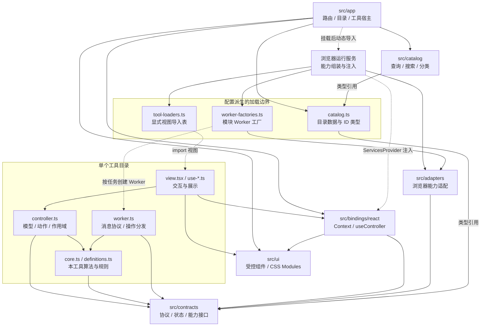
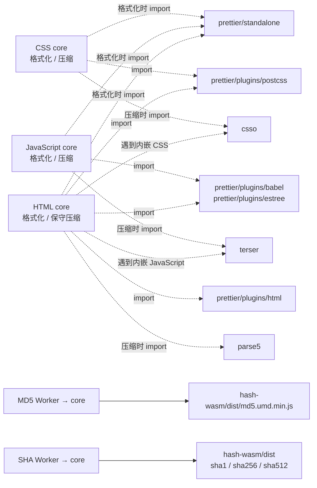
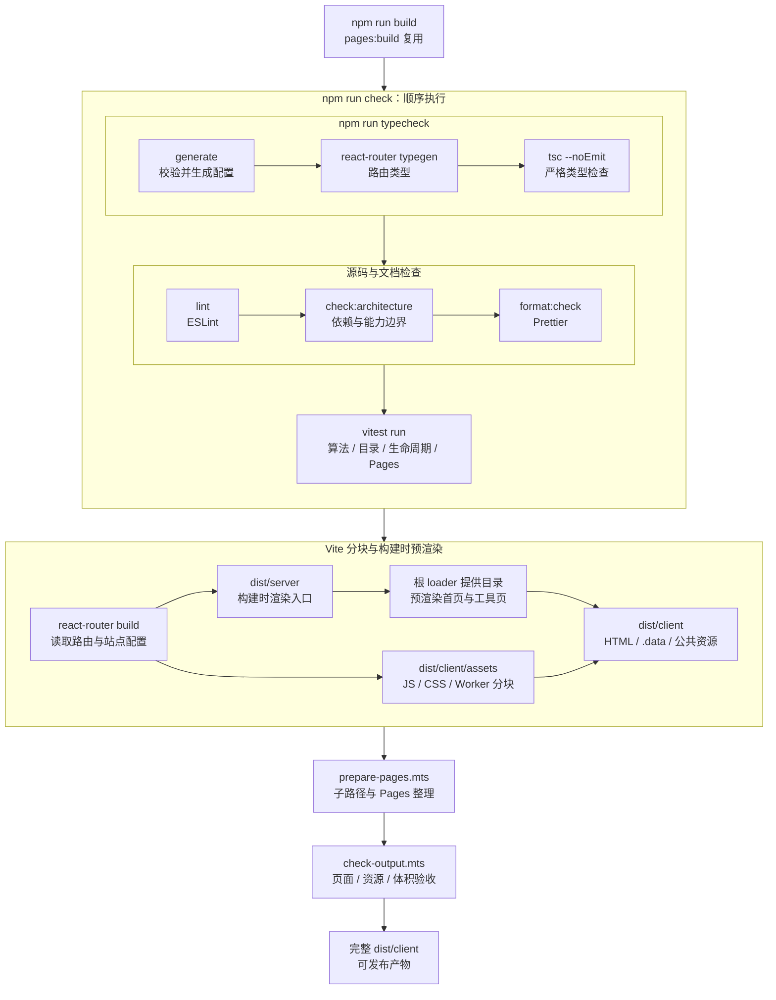
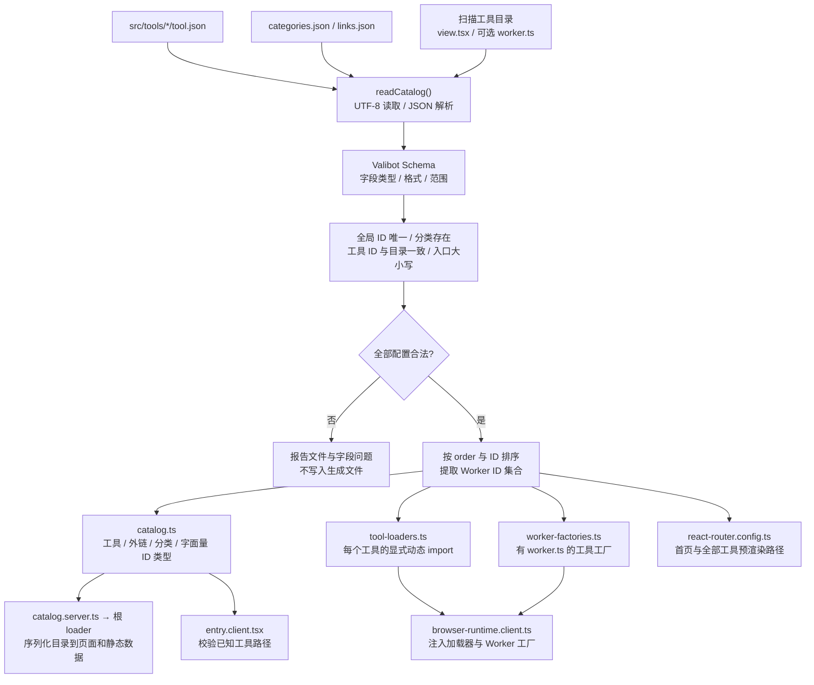
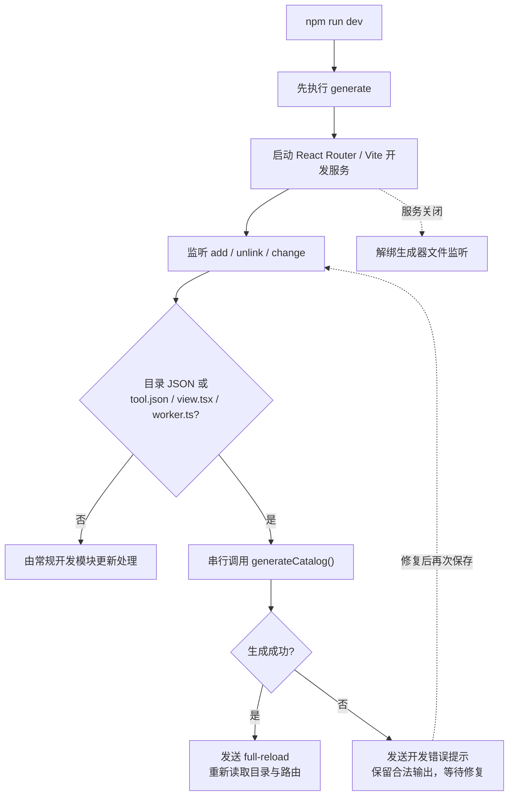
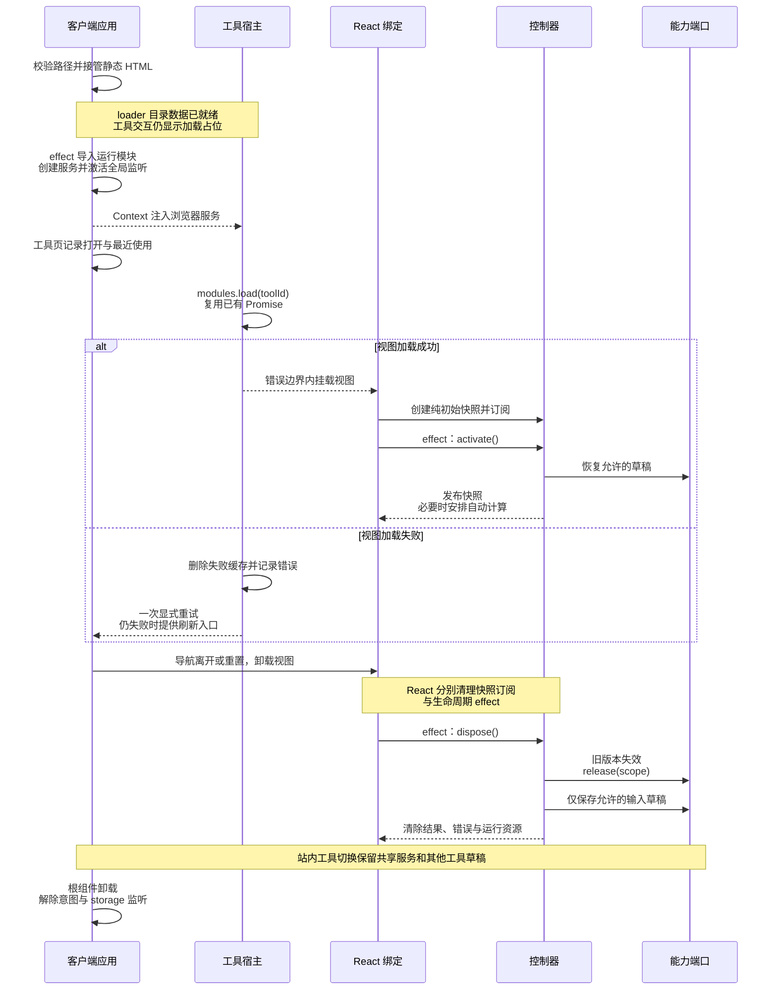
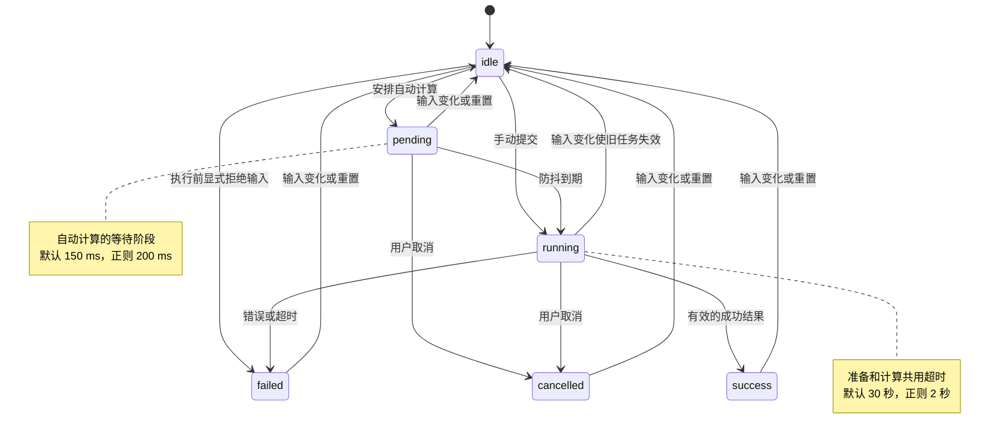
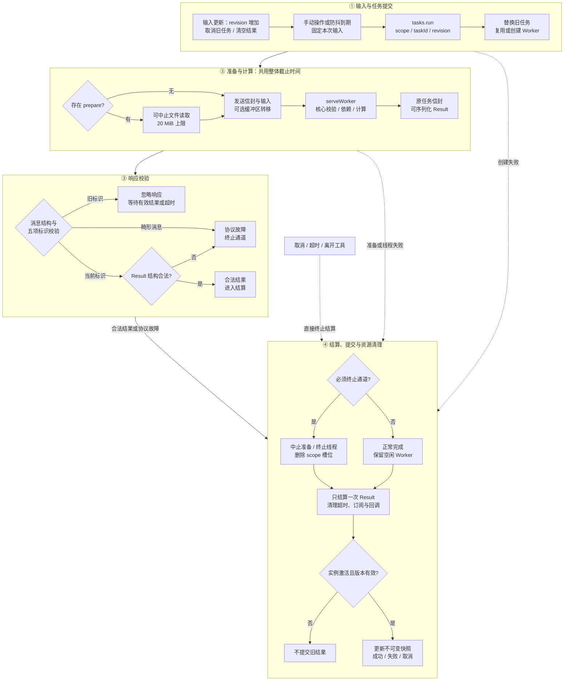
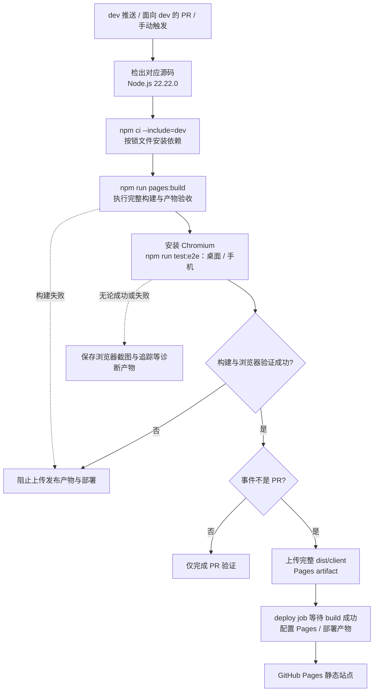

# RCtools 架构与约束

本项目是浏览器本地计算平台。React Router 8.4 Framework 负责静态页面与导航；工具的控制器和算法保持独立。JSON 配置是目录元数据的唯一来源。

[模块依赖](#模块依赖) · [构建流程](#构建流程) · [执行与资源生命周期](#执行与资源生命周期) · [状态规则](#状态规则) · [发布与回滚](#发布与回滚)

## 模块依赖

### 分层与能力注入

下图的实线 `A → B` 表示 A 引用 B；虚线注明动态加载、Worker 启动或能力注入。类型引用也受架构约束，但不会形成运行时脚本依赖。图中只展开主要跨层关系，同层实现细节仍由各模块维护。



| 目录                 | 职责与允许的依赖                                                       |
| -------------------- | ---------------------------------------------------------------------- |
| `src/contracts`      | 结果、状态、任务、能力协议及配置 Schema；独立于 React 和浏览器         |
| `src/catalog`        | 对序列化元数据进行查询、搜索和分类；不加载工具和导航                   |
| `src/tools/<id>`     | 自己的视图、控制器、核心和 Worker；不能引用其他工具                    |
| `src/bindings/react` | 服务注入、订阅、激活与释放；只依赖契约、React 和 UI                    |
| `src/ui`             | 受控展示组件和主题；不得引用工具、存储或浏览器适配器                   |
| `src/adapters`       | 文件、随机数、剪贴板、草稿、最近使用、日志与任务执行；不能导入工具实现 |
| `src/app`            | 组装能力、路由和宿主；不编写工具算法                                   |
| `src/generated`      | 生成目录、字面量 ID、视图加载映射和 Worker 工厂；不手工修改            |
| `build`              | 读取 UTF-8 JSON、校验、生成、架构与产物验证                            |

目录配置在构建时被根路由 loader 读取，预渲染到 HTML 及静态数据文件。客户端目录查询接收这些描述数据，避免再次把所有元数据打进 JavaScript。生成的组件表和 Worker 工厂在客户端能力边界延迟加载。Valibot 仅参与构建校验；客户端只使用推导的类型。

依赖方向由 [build/check-architecture.mts](./build/check-architecture.mts) 检查：契约只引用契约，适配器不反向引用工具，工具只能引用自己的实现。应用通过生成的加载表获取视图；控制器通过 `ControllerPorts` 使用任务、草稿和日志能力，不导入浏览器适配器。`core.ts`、控制器及其他可移植工具模块不得使用 React、DOM、浏览器存储或隐式随机源；`worker.ts` 是线程入口边界。

### 第三方依赖与加载时机

框架依赖进入应用外壳；工具实现通过视图和 Worker 边界加载。下图展开重型算法依赖，箭头表示对应核心实际使用的库，不表示这些库在首页启动时加载。



| 依赖组                                           | 使用位置与加载时机                                                                 |
| ------------------------------------------------ | ---------------------------------------------------------------------------------- |
| React、React DOM、React Router                   | 应用外壳、导航、组件订阅和客户端接管；构建端另外使用服务端渲染入口。               |
| Prettier 与解析插件、CSSO、Terser、parse5        | 格式化工具核心按操作动态导入；HTML 仅在需要处理对应内嵌内容时加载压缩器。          |
| hash-wasm                                        | MD5、SHA 的核心静态引用各算法分包；随对应 Worker 加载，执行摘要算法时初始化 WASM。 |
| Valibot、TypeScript、Vite、React Router 构建插件 | 配置校验、类型生成、依赖检查、分块与预渲染；不作为工具的浏览器计算服务。           |
| ESLint、Prettier、Vitest、Playwright             | 开发与发布验证；Prettier、Terser 同时有工具计算用途，加载边界按入口区分。          |

JSON 格式化使用自己的词法与结构校验，其他轻量转换主要使用语言内建能力。首页体积检查同时检查模块归属，防止工具实现及上述重型依赖进入初始加载链路。实际拆包规则见 [vite.config.ts](./vite.config.ts)，算法加载入口见各工具的 `core.ts`。

## 构建流程

### 完整构建与质量门禁

`npm run build` 先顺序执行 `npm run check`，再执行框架构建、Pages 整理和产物验收；`npm run pages:build` 复用同一流程。任一步骤失败都会中止后续步骤。CI 在安装锁文件依赖后执行构建，并额外执行浏览器测试与部署。



`generate → typegen → tsc` 是 `typecheck` 的内部顺序。`react-router.config.ts` 在类型生成和构建读取时还会调用 `generateCatalog()`，确保预渲染路径来自同一份合法配置；内容相同的生成文件不会重写。`ssr: false` 表示发布后使用静态托管，`dist/server` 仍用于构建时预渲染。

| 阶段           | 关键输入                                        | 输出或验收目标                                                                                 |
| -------------- | ----------------------------------------------- | ---------------------------------------------------------------------------------------------- |
| 配置生成       | `tool.json`、分类、外链与约定入口文件           | `catalog.ts`、`tool-loaders.ts`、`worker-factories.ts`。                                       |
| 类型与源码检查 | 生成文件、路由、全部维护源码与文档              | 路由类型；类型、规范、架构、格式和行为检查通过。                                               |
| 框架构建       | Vite 配置、路由配置、`build/site.mts`           | JS/CSS/Worker 分块、`bundle-report.json`、预渲染 HTML 与静态数据。                             |
| Pages 整理     | `dist/client`、基础路径、域名、源码版本和锁文件 | 子路径页面归位；`404.html`、`.nojekyll`、可选 `CNAME`、`tool-routes.json`、`build-info.json`。 |
| 产物验收       | 页面、资源地址、模块归属报告和初始脚本链路      | 所有工具入口可用；首页初始 JavaScript 的 Gzip 总量不超过 100 KiB，且不包含工具实现和重型库。   |

构建环境变量只在构建时生效：`PAGES_BASE_PATH` 接受 `/` 或不带尾斜杠的子路径，由 `build/site.mts` 统一转换为路由与资源使用的基础路径；`PAGES_CUSTOM_DOMAIN` 控制是否生成 CNAME。源码版本通过 `GITHUB_SHA` 进入构建标识，本地构建使用 `dev` 标识。

### 配置校验与生成数据流



只有完整配置校验成功后才开始写入，内容不变时跳过写入；配置校验失败会保留上一份合法输出。生成文件不手工修改，也不依赖提交到 Git。`ToolId` 等类型供编译期使用，客户端目录描述主要来自 loader 数据，启动入口只额外引用路径校验所需的 `TOOL_IDS`。

### 开发时的重新生成流程



监听器实现在 [vite.config.ts](./vite.config.ts) 中。快速连续保存通过同一 Promise 队列串行处理，避免多个生成过程交叉写入；普通算法或样式修改交由 Vite 自身处理。

## 执行与资源生命周期

### 页面启动、工具挂载与离开

构建时先输出工具详情外壳与加载占位；浏览器接管后，在根组件 effect 内创建服务，再由工具宿主加载视图。首页卡片的鼠标或触控笔悬停 120 ms、键盘聚焦可提前加载视图，成功或正在进行的模块 Promise 会复用，预加载不创建控制器或 Worker。



控制器创建阶段不读取外部状态、不启动任务；`activate()` 与 `dispose()` 幂等，并允许同一实例在 StrictMode 的 effect 清理后再次激活。工具 ID 变化会使旧宿主的加载回调失效，迟到的模块加载不会挂载到新工具。渲染失败由工具错误边界隔离；重置会清除该工具草稿并重建视图和控制器。根服务导入失败由应用显示重新打开入口。

实现入口：[root.tsx](./src/app/root.tsx)、[browser-runtime.client.ts](./src/app/browser-runtime.client.ts)、[tool-host.tsx](./src/app/tool-host.tsx)、[React 控制器绑定](./src/bindings/react/controller.ts)。

### 控制器任务状态

状态描述属于控制器展示协议。下图展示 Worker 计算的典型迁移；同步轻量工具直接更新模型字段，通常不经过 `pending` 或 `running`。`running` 覆盖异步准备和实际计算，文件读取没有另一个公开任务状态。



完成、失败或取消后，可以再次提交到 `running`。释放实例时统一回到 `idle`，清理结果和错误；之后若再次激活，可恢复允许的输入并重新安排自动计算。用户取消显示 `cancelled`，不显示失败信息；输入变化导致的取消先使旧版本失效，再进入新输入的 `idle` 或 `pending` 状态。

### 一次计算、结果校验与终止



时间戳、时间差、颜色和密码直接调用轻量算法。JSON、CSS、JavaScript、HTML、Base64、故障文字、MD5 和 SHA 点击后交给 Worker，默认超时 30 秒。文本统计、进制与 IEEE-754 在 150 ms 防抖后计算；正则保留 200 ms 防抖、2 秒超时和 500 条展示上限。

`createOperationController` 用于单次计算或自动计算；`createModelController` 用于多输入与多动作模型。二者都提供稳定的 `getSnapshot`、订阅、`activate` 和 `dispose`，React 绑定用 `useSyncExternalStore` 读取。快照只包含不可变展示数据，业务操作放在引用稳定的 `actions` 中，操作始终访问当前模型。文件读取句柄留在控制器内部，视图只读取文件名称和大小。初始快照不读取浏览器状态，激活发生在 effect 内，支持 StrictMode 重复激活与释放。

同一作用域只保留最新任务。响应必须匹配工具、操作、作用域、任务 ID 和输入版本。输入变化立即清空旧结果；取消属于正常状态。Worker 成功后可以复用；取消、超时、协议异常、资源失败或离开工具时释放。文件最大 20 MiB，文件对象留在浏览器边界，核心只接收字节。

执行器先验证 `toolId`、`operation`、`scope`、`taskId`、`revision`，再检查 `Result` 结构；控制器在提交前还检查实例是否激活和输入版本是否仍有效，单操作控制器另核对当前任务句柄。合法的普通校验失败也可以复用 Worker；资源加载失败会销毁线程，以便下次操作创建新的加载环境。文件读取完成后还会检查任务是否已结算，避免取消后继续发送字节。实现见 [tasks.ts](./src/adapters/tasks.ts)、[Worker 协议桥](./src/contracts/worker.ts) 与 [文件读取适配器](./src/adapters/files.ts)。

输入校验由工具的视图、控制器或核心按操作需要执行，核心校验可能在 Worker 内完成。文件准备、依赖加载和算法计算共享同一个任务截止时间；超时会同时停止准备和线程。`scope` 按控制器实例分配，同一工具的多个实例不会互相取消。

### 资源归属与释放路径

| 资源                               | 拥有者                 | 结束或释放路径                                                                          |
| ---------------------------------- | ---------------------- | --------------------------------------------------------------------------------------- |
| 控制器快照订阅                     | `useSyncExternalStore` | 组件卸载时退订；控制器的激活与释放由绑定 effect 管理。                                  |
| 防抖定时器、当前任务和 Worker 槽位 | 控制器与任务执行器     | 输入变化或取消撤销当前任务；`dispose()` 调用 `release(scope)`，连空闲 Worker 一起释放。 |
| FileReader 与取消订阅              | 文件准备阶段           | 成功、失败或取消时移除读取回调与取消订阅；取消、超时及页面离开可中止读取。              |
| 文件资源、摘要结果和密码           | 当前工具控制器         | 文件和结果不保存为草稿；释放后重建模型，密码工具的保留字段清单为空。                    |
| 视图模块 Promise 缓存              | 页面级模块加载器       | 导航时复用成功加载；失败删除缓存，显式重试调用 `reset(id)`，刷新后重新创建服务。        |
| 卡片意图监听与 120 ms 定时器       | 浏览器运行服务         | 离开卡片撤销等待；根组件卸载时移除所有意图监听和定时器。                                |
| 最近使用的 `storage` 监听          | 页面级最近使用服务     | 根组件激活服务时订阅，运行服务 `dispose()` 时解绑；存储失败保留内存快照。               |

站内导航释放当前工具实例，页面级草稿、模块缓存和日志仍供后续工具使用；整页刷新则重新创建这些内存服务。草稿保留策略与状态归属见下节。

控制器不得把 UI 组件、文件对象、结果、异常或运行句柄写入草稿。算法不得隐式改变编码、去除空白或转换数值；输入规则由本工具决定。

## 状态规则

| 状态                 | 归属与保留规则                                                             |
| -------------------- | -------------------------------------------------------------------------- |
| 当前工具             | URL 路径                                                                   |
| 搜索和分类           | URL 的 `q`、`category` 参数；工具返回链接保留来源地址                      |
| 最近使用             | `toolbox:recent:v1`，去重和过滤失效 ID，最多 3 项，存储失败降级到内存      |
| 2048 棋局与最高分    | `toolbox:2048:v1` 独立版本化存档，刷新后恢复；存储失败保留页面内副本并提示 |
| 输入和选项           | 页面内存草稿，导航后恢复，刷新清除；16 MiB 总预算与 LRU 淘汰               |
| 密码和文件           | 当前工具实例；离开、清空或释放后丢弃                                       |
| 输出、错误、任务     | 控制器，输入修改立即失效                                                   |
| 焦点、折叠、复制反馈 | 视图与 React 绑定，使用者清理计时器和订阅                                  |

超过预算的单份草稿只在当前页面可用，界面提示离开不会保留。密码配置 `draft: "none"`，控制器不声明持久输入；文件不出现在任何草稿字段中。

2048 同样配置 `draft: "none"`，游戏数据不进入普通输入草稿。`PersistentStore` 通过 `BrowserServices.storage` 注入，提供 `read(key): Result<unknown>` 与 `write(key, value): Result<void>`；浏览器存储和 JSON 副本缓存由适配器封装，`ControllerPorts` 保持不变。创建控制器不读存储或生成随机块，激活后校验存档，移动、重开和继续挑战时立即保存；动画、错误和任务不存档。存储受限时允许站内往返恢复页面内副本，并提示刷新后可能丢失；首版不做多标签页实时同步。

## 错误和日志

所有跨边界失败使用 `AppError`，字段是 `kind`、`code`、中文 `message` 与可选 `line`、`column`。预期失败放入 `Result` 的 `ok: false` 分支；Worker 只传递可序列化错误。

| kind        | 负责的边界与恢复                                             |
| ----------- | ------------------------------------------------------------ |
| validation  | 工具输入与解析；显示字段或行列信息，修改输入后恢复           |
| resource    | 模块或专属依赖加载；应用缓存删除拒绝结果，提供有限重试与刷新 |
| execution   | 未知计算或 Worker 协议异常；终止任务并允许再次执行           |
| timeout     | 终止 Worker，提示缩短输入或简化表达式                        |
| unsupported | 显示浏览器能力要求                                           |
| storage     | 内存降级，不阻断使用                                         |
| render      | 当前工具错误边界隔离，提供重置与诊断复制                     |
| cancelled   | 正常结束，不显示失败                                         |

解析错误保留结构化位置；下载错误不得包装成语法错误。错误提示不拼接用户内容、解析器源码摘录或异常堆栈。模块预加载和所有后台 Promise 必须处理拒绝。浏览器可能缓存失败的原生模块求值，因此一次重试仍失败时允许用户刷新，禁止自动刷新循环。

日志最多保存当前页面最近 500 条，不上传，不写入持久存储。只有以下字段可以进入日志：

```text
timestamp level event buildId sessionId toolId operation taskId phase durationMs errorCode
```

`debug` 用于开发校验，`info` 用于打开和任务生命周期，`warn` 用于超时、能力不足与存储降级，`error` 用于界面、Worker 和未知失败。归类的边界只记录一次；普通输入错误不产生生产错误日志。日志适配器以外禁止直接使用 `console`，生产构建去掉库的控制台输出，内存诊断记录仍保留。复制诊断信息由用户主动触发。

## 代码与质量门禁

- UTF-8、LF、两空格；Prettier 与 EditorConfig 保持一致。
- ID 和工具目录使用小写短横线；组件 PascalCase，函数和变量 camelCase。
- 严格类型、索引访问检查、可选属性检查；边界使用 `unknown` 并收窄；类型依赖用 `import type`。
- 算法与控制器不依赖 React、DOM、布局或浏览器存储。时间与随机源通过能力或参数注入。
- 视图不创建 Worker，公共控件不读取存储或算法；渲染保持纯净。
- 使用明确的任务状态联合，不用相互矛盾的运行布尔值管理生命周期。
- 全局 CSS 仅包含主题与基础规则；控件和页面使用 CSS Modules，标记外观由配置控制。
- 重型解析器、压缩器和 WASM 在对应工具操作时加载。
- 资源使用者负责取消与释放；订阅、文件读取、定时器、Worker 都要有结束路径。
- 新验证放在 `quality`；旧测试目录不参与架构验收。

TypeScript AST 检查静态导入、动态导入、重导出、类型导入、路径别名及循环。跨工具引用、公共 UI 引用实现、核心引用 UI/浏览器能力和计算式动态导入都阻止发布。

构建验收首页脚本、模块预加载和静态依赖的 Gzip 总量尽量小；HTML 内的静态目录数据单独随页面传输。检查所有工具标题、简介、交互占位、CSS/资源地址和辅助 Pages 文件。Worker 大分块只按实际加载链路验收。

## 发布与回滚



本地 `npm run build` 在产物验收后结束；`npm run test:e2e` 是独立命令，使用已构建的站点启动预览并验证交互。CI 将两者串联，浏览器诊断产物与 Pages 发布产物分别保存；PR 不上传 Pages 产物，也不执行部署。工作流见 [.github/workflows/deploy-pages.yml](./.github/workflows/deploy-pages.yml)。

源码继续在 `dev` 维护，工作流上传 `dist/client` 并由 Pages Actions 部署，不再强推产物到 `main`。首次切换在 GitHub 的 Settings → Pages → Build and deployment 中选择 **GitHub Actions**，保留旧 `main` 产物。

`PAGES_BASE_PATH` 同时控制资源、路由和预渲染路径。路由和资源基路径统一带尾部斜杠，生成的子路径页面在 Pages 整理阶段移到客户端产物根目录，避免仓库路径重复两次。默认 `/` 与 `tool.raincither.top`；将 `PAGES_CUSTOM_DOMAIN` 设为空字符串即可不生成 CNAME。发布记录包含源码提交、锁文件摘要和构建版本。回滚选择稳定源码提交，使用该版本锁文件重新构建并部署整套产物。

参考：[React Router 预渲染](https://reactrouter.com/how-to/pre-rendering)、[React 外部状态订阅](https://react.dev/reference/react/useSyncExternalStore)、[GitHub Pages 工作流](https://docs.github.com/en/pages/getting-started-with-github-pages/using-custom-workflows-with-github-pages)。
