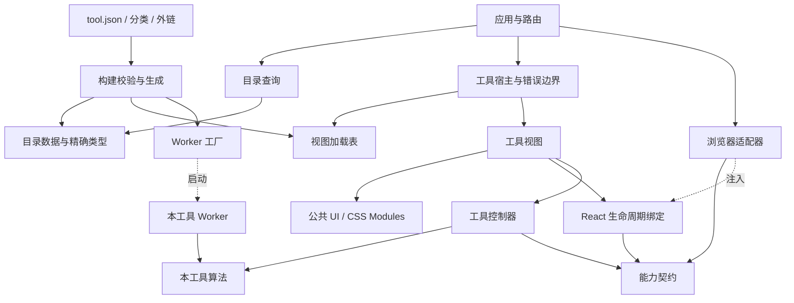
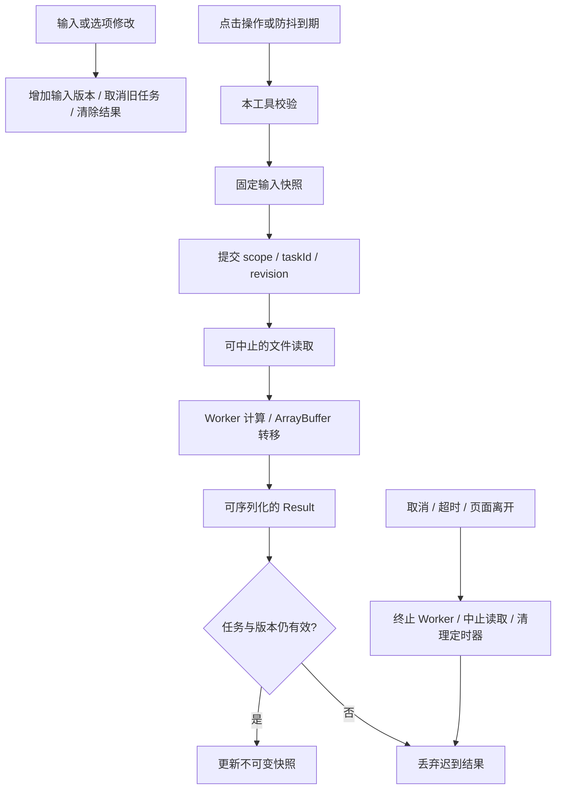

# RCtools 架构与约束

本项目是浏览器本地计算平台。React Router 8.4 Framework 负责静态页面与导航；工具的控制器和算法保持独立。JSON 配置是目录元数据的唯一来源。

## 模块依赖



| 目录                 | 职责与允许的依赖                                                       |
| -------------------- | ---------------------------------------------------------------------- |
| `src/contracts`      | 结果、状态、任务、能力协议及配置 Schema；独立于 React 和浏览器         |
| `src/catalog`        | 对序列化元数据进行查询、搜索和分类；不加载工具和导航                   |
| `src/tools/<id>`     | 自己的视图、控制器、核心和 Worker；不能引用其他工具                    |
| `src/bindings/react` | 服务注入、订阅、激活与释放；只依赖契约、React 和 UI                    |
| `src/ui`             | 受控展示组件和主题；不得引用工具、存储或浏览器适配器                   |
| `src/adapters`       | 文件、随机数、剪贴板、草稿、最近使用、日志与任务执行；不能导入工具实现 |
| `src/app`            | 组装能力、路由和宿主；不编写工具算法                                   |
| `src/generated`      | 生成目录、字面量 ID、视图加载映射和 Worker 工厂；不手工修改            |
| `build`              | 读取 UTF-8 JSON、校验、生成、架构与产物验证                            |

目录配置在构建时被根路由 loader 读取，预渲染到 HTML 及静态数据文件。客户端目录查询接收这些描述数据，避免再次把所有元数据打进 JavaScript。生成的组件表和 Worker 工厂在客户端能力边界延迟加载。Valibot 仅参与构建校验；客户端只使用推导的类型。

## 执行与资源生命周期



时间戳、时间差、颜色和密码直接调用轻量算法。JSON、CSS、JavaScript、HTML、Base64、故障文字、MD5 和 SHA 点击后交给 Worker，默认超时 30 秒。文本统计、进制与 IEEE-754 在 150 ms 防抖后计算；正则保留 200 ms 防抖、2 秒超时和 500 条展示上限。

`createOperationController` 用于单次计算或自动计算；`createModelController` 用于多输入与多动作模型。二者都提供稳定的 `getSnapshot`、订阅、`activate` 和 `dispose`，React 绑定用 `useSyncExternalStore` 读取。快照只包含不可变展示数据，业务操作放在引用稳定的 `actions` 中，操作始终访问当前模型。文件读取句柄留在控制器内部，视图只读取文件名称和大小。初始快照不读取浏览器状态，激活发生在 effect 内，支持 StrictMode 重复激活与释放。

同一作用域只保留最新任务。响应必须匹配工具、操作、作用域、任务 ID 和输入版本。输入变化立即清空旧结果；取消属于正常状态。Worker 成功后可以复用；取消、超时、协议异常、资源失败或离开工具时释放。文件最大 20 MiB，文件对象留在浏览器边界，核心只接收字节。

控制器不得把 UI 组件、文件对象、结果、异常或运行句柄写入草稿。算法不得隐式改变编码、去除空白或转换数值；输入规则由本工具决定。

## 状态规则

| 状态                 | 归属与保留规则                                                        |
| -------------------- | --------------------------------------------------------------------- |
| 当前工具             | URL 路径                                                              |
| 搜索和分类           | URL 的 `q`、`category` 参数；工具返回链接保留来源地址                 |
| 最近使用             | `toolbox:recent:v1`，去重和过滤失效 ID，最多 3 项，存储失败降级到内存 |
| 输入和选项           | 页面内存草稿，导航后恢复，刷新清除；16 MiB 总预算与 LRU 淘汰          |
| 密码和文件           | 当前工具实例；离开、清空或释放后丢弃                                  |
| 输出、错误、任务     | 控制器，输入修改立即失效                                              |
| 焦点、折叠、复制反馈 | 视图与 React 绑定，使用者清理计时器和订阅                             |

超过预算的单份草稿只在当前页面可用，界面提示离开不会保留。密码配置 `draft: "none"`，控制器不声明持久输入；文件不出现在任何草稿字段中。

## 错误和日志

所有跨边界失败使用 `AppError`，字段是 `kind`、`code`、中文 `message` 与可选 `line`、`column`。预期失败放入 `Result` 的 `ok: false` 分支；Worker 只传递可序列化错误。

| kind        | 负责的边界与恢复                                             |
| ----------- | ------------------------------------------------------------ |
| validation  | 工具输入与解析；显示字段或行列信息，修改输入后恢复           |
| resource    | 模块或专属依赖加载；应用缓存删除拒绝结果，提供有限重试与刷新 |
| execution   | 未知计算或 Worker 协议异常；终止任务并允许再次执行           |
| timeout     | 终止 Worker，提示缩短输入或简化表达式                        |
| unsupported | 显示浏览器能力要求                                           |
| storage     | 内存降级，不阻断使用                                         |
| render      | 当前工具错误边界隔离，提供重置与诊断复制                     |
| cancelled   | 正常结束，不显示失败                                         |

解析错误保留结构化位置；下载错误不得包装成语法错误。错误提示不拼接用户内容、解析器源码摘录或异常堆栈。模块预加载和所有后台 Promise 必须处理拒绝。浏览器可能缓存失败的原生模块求值，因此一次重试仍失败时允许用户刷新，禁止自动刷新循环。

日志最多保存当前页面最近 500 条，不上传，不写入持久存储。只有以下字段可以进入日志：

```text
timestamp level event buildId sessionId toolId operation taskId phase durationMs errorCode
```

`debug` 用于开发校验，`info` 用于打开和任务生命周期，`warn` 用于超时、能力不足与存储降级，`error` 用于界面、Worker 和未知失败。归类的边界只记录一次；普通输入错误不产生生产错误日志。日志适配器以外禁止直接使用 `console`，生产构建去掉库的控制台输出，内存诊断记录仍保留。复制诊断信息由用户主动触发。

## 代码与质量门禁

- UTF-8、LF、两空格；Prettier 与 EditorConfig 保持一致。
- ID 和工具目录使用小写短横线；组件 PascalCase，函数和变量 camelCase。
- 严格类型、索引访问检查、可选属性检查；边界使用 `unknown` 并收窄；类型依赖用 `import type`。
- 算法与控制器不依赖 React、DOM、布局或浏览器存储。时间与随机源通过能力或参数注入。
- 视图不创建 Worker，公共控件不读取存储或算法；渲染保持纯净。
- 使用明确的任务状态联合，不用相互矛盾的运行布尔值管理生命周期。
- 全局 CSS 仅包含主题与基础规则；控件和页面使用 CSS Modules，标记外观由配置控制。
- 重型解析器、压缩器和 WASM 在对应工具操作时加载。
- 资源使用者负责取消与释放；订阅、文件读取、定时器、Worker 都要有结束路径。
- 新验证放在 `quality`；旧测试目录不参与架构验收。

TypeScript AST 检查静态导入、动态导入、重导出、类型导入、路径别名及循环。跨工具引用、公共 UI 引用实现、核心引用 UI/浏览器能力和计算式动态导入都阻止发布。

构建验收首页脚本、模块预加载和静态依赖的 Gzip 总量不超过 100 KiB；HTML 内的静态目录数据单独随页面传输。检查所有工具标题、简介、交互占位、CSS/资源地址和辅助 Pages 文件。Worker 大分块只按实际加载链路验收。

## 发布与回滚


开发命令启动前生成配置，监听 JSON 与入口增删。非法配置不覆盖上一份合法生成文件，开发界面显示错误；修复后恢复。类型检查和构建自行生成，不依赖提交生成文件。

源码继续在 `dev` 维护，工作流上传 `dist/client` 并由 Pages Actions 部署，不再强推产物到 `main`。首次切换在 GitHub 的 Settings → Pages → Build and deployment 中选择 **GitHub Actions**，保留旧 `main` 产物。

`PAGES_BASE_PATH` 同时控制资源、路由和预渲染路径。路由和资源基路径统一带尾部斜杠，生成的子路径页面在 Pages 整理阶段移到客户端产物根目录，避免仓库路径重复两次。默认 `/` 与 `tool.raincither.top`；将 `PAGES_CUSTOM_DOMAIN` 设为空字符串即可不生成 CNAME。发布记录包含源码提交、锁文件摘要和构建版本。回滚选择稳定源码提交，使用该版本锁文件重新构建并部署整套产物。

参考：[React Router 预渲染](https://reactrouter.com/how-to/pre-rendering)、[React 外部状态订阅](https://react.dev/reference/react/useSyncExternalStore)、[GitHub Pages 工作流](https://docs.github.com/en/pages/getting-started-with-github-pages/using-custom-workflows-with-github-pages)。
